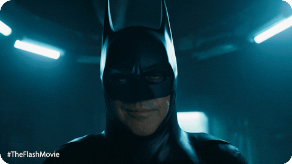

 

# Hi, I'm Sayantan Pal 👋

 

 

---

## 🧑‍💻 About Me

- 🎓 Computer Science & Engineering student.
- 💻 Full-Stack Developer working with **React, Next.js, JavaScript, Python and Django**.
- 🎨 UI/UX enthusiast who enjoys building polished, responsive and accessible interfaces.
- 🤖 Exploring AI/ML and AI-powered application development.
- 🏆 Hackathon winner with **Team OverClockers – GDGC MSIT**.
- 🌱 Currently strengthening my DSA, problem-solving and software engineering fundamentals.
- 🚀 Interested in building useful products, collaborating with developers and learning by shipping.

## 🛠️ Tech Stack

### Languages

### Frontend

### Full-Stack & Other

**MERN Stack** (MongoDB, Express, React, Node.js)

### Interests

-5C3EE8?style=for-the-badge)

---

## 🏆 Achievements

**Back-to-back hackathon wins — Team OverClockers**

- 🥇 Winner at GDGC MSIT Hackathon.
- 👥 Built and presented solutions as part of a four-member team.
- 💡 Enjoy turning real-world problems into practical software prototypes.

## 🚀 Featured Projects

| Project | What it is | Stack |
|---|---|---|
| [Carcino Foundation](https://carcino-foundation-new.vercel.app/) | Foundation website and custom CMS work | Next.js, Django |
| [LuminoLens](https://luminolens-phi.vercel.app/) | Blue-light glasses product and educational microsite | Web development |
| [Project Greenovation](https://github.com/sabkabap2006/Project-Greenovation) | Environmental technology initiative | Full-stack development |
| [MetroAI](https://github.com/sabkabap2006) | Intelligent metro management concept | AI, web development |

> Add or replace project links as you publish more repositories.

---

## 🧠 DSA & TakeUForward Progress

  

<!-- TakeUForward username: brocoder2006 -->

 

<a href="https://takeuforward.org/">
  Practice DSA on TakeUForward
</a>

**Topics I'm working through:**
- Arrays, strings, sorting and searching
- Recursion and backtracking
- Linked lists, stacks and queues
- Binary trees, BSTs and graphs
- Greedy algorithms and dynamic programming

TakeUForward profile: [brocoder2006](https://takeuforward.org/profile/brocoder2006). The stats card uses a community-built API, not an official TakeUForward widget.

---

## 📈 GitHub Stats

 

## 🏆 GitHub Trophies

## 🐍 Contribution Snake

To enable this animation, configure a GitHub Actions workflow in your profile repository to generate and publish the `output` branch. Until then, this image may not appear.

---

## 😂 Developer Life

### "One small CSS change" — 3 hours later...

**Plan → Code → Debug → Search → Fix → Repeat**

---

## 🤝 Let's Connect

  

**Open to learning, building and collaborating on interesting projects.**

### Eat. Sleep. Code. Repeat. 💻

